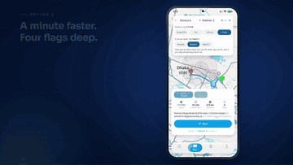
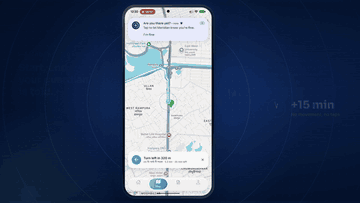
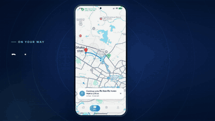
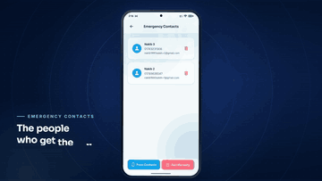
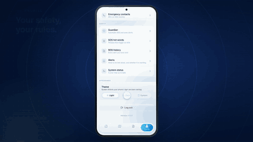
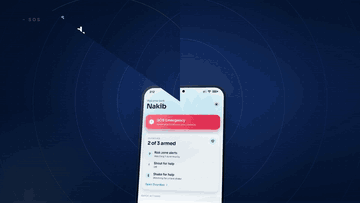
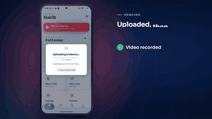
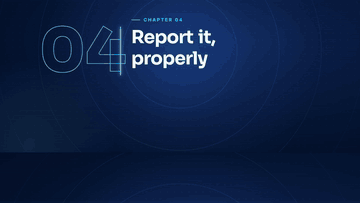
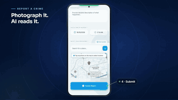
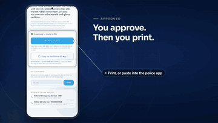

<div align="center">


# Meridian

### Agentic safety navigation for Bangladesh

**নিরাপদ পথ, প্রতিটি যাত্রায়** — *a safe road, on every journey*

[](https://expo.dev)
[](https://reactnative.dev)
[](https://www.typescriptlang.org)
[](https://fastapi.tiangolo.com)
[](https://supabase.com)
[](https://redis.io)
[](https://docs.celeryq.dev)
[](https://docs.docker.com/compose/)
[](https://ai.google.dev)
[](https://project-osrm.org)

**MD Arafat Ullah** · **Nakib Saleh** · **Farhan Ishraq**

<sub>Hack for Humanity 2026 · The AI Collective Bangladesh · Track 3 — Smart Society & Public Services</sub>

[⬇ Download the app](#install-it) · [▶ Demo video](https://youtu.be/FvKNAmrX3l0) · [Watch it run](#watch-it-run) · [What it does](#what-it-does) · [Architecture](#architecture) · [Running it](#running-it) · [Agent fleet](#the-agent-fleet) · [Privacy](#privacy-and-the-limits-we-state-out-loud)

</div>

---

Every navigation app in Dhaka answers one question: *what is the fastest route?*
Meridian answers the one that matters more — *is this road safe right now?*

A layer of autonomous agents reads the city continuously — newspaper sitemaps, a
police newsroom, published announcements — and turns scattered public information
into a **live risk surface that decays**. On top of that surface sit safety-weighted
routing, AI-assisted incident reporting, journey monitoring, zone alerts and
emergency SOS. After an incident, an agent drafts the formal Bangla **General
Diary**, so the incident becomes recorded data instead of vanishing — which
improves the map for the next traveller.

> **The core insight:** the information needed to keep people safe is already
> public. Nobody reads the city fast enough to warn anyone in time. Agents can.

Built for **Hack for Humanity 2026** (The AI Collective Bangladesh), Track 3 —
Smart Society & Public Services. See
[Meridian_Concept_Document.md](Meridian_Concept_Document.md) for the full pitch.

---

## Install it

<div align="center">

### [⬇&nbsp; Download Meridian for Android](https://expo.dev/artifacts/eas/S3LluEatUk8M7JtWYEyuJWunCKhBBGo9_Nuo5icW4UE.apk)

<sub><b>APK · 117 MB · Android</b> — no Play Store, no account, no device registration</sub>

</div>

Open that link on an Android phone and tap the downloaded file. The first time, the
phone asks whether to allow installs from your browser; that prompt is ordinary for
an app distributed outside the Play Store.

Nothing needs configuring. The build ships pointed at our live backend, so the Dhaka
risk surface is already on the map when you sign up — everything in the film below
is running against the same deployment you get.

The [build page](https://expo.dev/accounts/warfather0991/projects/Meridian/builds/78d7ce46-9348-4872-9be8-cc7fc84cc447) always carries the
current APK and a QR code for it, which is the link to use if the direct download
above ever goes stale.

---

## Watch it run

<div align="center">

<a href="https://youtu.be/FvKNAmrX3l0"></a>

<sub>▶ <b><a href="https://youtu.be/FvKNAmrX3l0">Watch the full demo on YouTube</a></b></sub>

</div>

The same film, cut into the scenes it plays in. Every screen is the running app on
a handset; every number on it was read off the live system.

### Opening

<table>
  <tr>
    <td width="33%" align="center"><br><sub><b>Sign in</b><br>Supabase Auth, the only identity provider</sub></td>
    <td width="33%" align="center"><br><sub><b>Setting up your safety zone</b><br>The launch animation</sub></td>
    <td width="33%" align="center"><br><sub><b>Safety at a glance</b><br>SOS, Guardian status, four quick actions</sub></td>
  </tr>
</table>

### 01 · The city reads itself

<table>
  <tr>
    <td width="33%" align="center"><br><sub><b>The city, flagged live</b><br>Risk flags read from the news</sub></td>
    <td width="33%" align="center"><br><sub><b>News in, risk flags out</b><br>Every article, and the flag it produced</sub></td>
    <td width="33%" align="center"><br><sub><b>Risk fades as news ages</b><br>Severity decays on a half-life</sub></td>
  </tr>
</table>

### 02 · One route is clean

<table>
  <tr>
    <td width="33%" align="center"><br><sub><b>Type it, pick it</b><br>From Rampura to Gulshan 2</sub></td>
    <td width="33%" align="center"><br><sub><b>Safety first, speed second</b><br>A minute faster is four flags deep</sub></td>
    <td width="33%" align="center"><br><sub><b>Start, and your guardian is told</b><br>One email, no live tracking</sub></td>
  </tr>
  <tr>
    <td width="33%" align="center"><br><sub><b>No movement? Meridian asks</b><br>A check-in push first</sub></td>
    <td width="33%" align="center"><br><sub><b>No answer</b><br>Then the guardian gets an email</sub></td>
    <td width="33%" align="center"><br><sub><b>Home safe, guardian told</b><br>The journey ends itself on arrival</sub></td>
  </tr>
</table>

### 03 · Help, right now

<table>
  <tr>
    <td width="33%" align="center"><br><sub><b>Who you are, kept current</b><br>The name every alert carries</sub></td>
    <td width="33%" align="center"><br><sub><b>Emergency contacts</b><br>The people who get the call</sub></td>
    <td width="33%" align="center"><br><sub><b>Your safety, your rules</b><br>Guardian, hot words, history, status</sub></td>
  </tr>
  <tr>
    <td width="33%" align="center"><br><sub><b>Light or dark</b><br>Or follow the system</sub></td>
    <td width="33%" align="center"><br><sub><b>Say the word, help is sent</b><br>Hot words, matched on the device</sub></td>
    <td width="33%" align="center"><br><sub><b>Three ways to call for help</b><br>Shout, shake, or press</sub></td>
  </tr>
  <tr>
    <td width="33%" align="center"><br><sub><b>Recording evidence</b><br>A 10-second clip, sent when it ends</sub></td>
    <td width="33%" align="center"><br><sub><b>Uploaded, then sent</b><br>Name, time, place and video, by email</sub></td>
    <td width="33%" align="center"><br><sub><b>SOS history</b><br>Every alert, delivered</sub></td>
  </tr>
</table>

### 04 · Report it, properly

<table>
  <tr>
    <td width="33%" align="center"><br><sub><b>Every report, on record</b><br>Your reports, in one list</sub></td>
    <td width="33%" align="center"><br><sub><b>Photograph it, AI reads it</b><br>Category, photo, place, submit</sub></td>
    <td width="33%" align="center"><br><sub><b>It describes, it never accuses</b><br>Visible cues, not a crime label</sub></td>
  </tr>
  <tr>
    <td width="33%" align="center"><br><sub><b>Drafted in Bangla</b><br>The General Diary, written by an agent</sub></td>
    <td width="33%" align="center"><br><sub><b>You approve</b><br>Every word, before anything leaves</sub></td>
    <td width="33%" align="center"><br><sub><b>Then you print</b><br>The DMP form, or paste into the police app</sub></td>
  </tr>
</table>

<sub>27 clips in [docs/demo/](docs/demo/), in the order the film plays them · 360 px, 8 fps, about 12 MB in all.</sub>

---

## Contents

- [Install it](#install-it)
- [Watch it run](#watch-it-run)
- [What it does](#what-it-does)
- [Architecture](#architecture)
- [Technology](#technology)
- [Repository layout](#repository-layout)
- [Running it](#running-it)
- [Configuration](#configuration)
- [Database and migrations](#database-and-migrations)
- [Testing and quality gates](#testing-and-quality-gates)
- [The agent fleet](#the-agent-fleet)
- [Privacy, and the limits we state out loud](#privacy-and-the-limits-we-state-out-loud)
- [Decision records](#decision-records)
- [Project status](#project-status)
- [How we work](#how-we-work)
- [Licensing](#licensing)
- [Team](#team)

---

## What it does

### 1. A live risk surface, not a crime archive

Ten publishers are polled: eight newspaper and TV news sitemaps (Prothom Alo,
Jugantor, Samakal, Ittefaq, Bangla Tribune, Dhaka Tribune, Ekattor, ITV), Channel
24, and **DMP's own newsroom** — the police, via RSS with the body in the feed.

What makes it a *surface* rather than a feed:

- **Flags decay.** Every flag stores a derived `expires_at`, and severity is
  recomputed at read time with a time-of-day multiplier. Ask for the surface
  `as_of` a future instant and short-lived flags **drop out** — measured against
  the D01 fixture: 20 flags now, 16 in six hours, 10 in twelve, 4 in two days.
  There are no stale red zones because nothing has to sweep them away.
- **Corroboration is required.** A flag is `confirmed` only when **two or more
  independent publishers** report it. Rumour Guard and Crime Guard use sentence
  embeddings, cosine similarity and a distance rule so four outlets covering one
  fire become one confirmed flag, not four. Dhaka newsrooms run the same agency
  copy, so independence is computed, not assumed.
- **Tomorrow is on the map today.** Processions, strikes and roadworks announced
  for a future date get a `valid_from`, so the warning is visible before the day
  arrives.
- **Bangla place names resolve.** A hand-harvested gazetteer of **6,054 entries**
  (3,241 of them named roads) backs an LLM geocoder. Held-out accuracy **95.6%**,
  with **0 fabrications and 0 wrong pins** — a model that invented coordinates for
  a place that does not exist was rejected during selection for exactly that.

### 2. Safety-weighted routing

Routes are scored on distance *and* exposure to the live surface. Alternatives are
real detours, not reorderings, and every route card explains **why** it was ranked
where it was. The app states which engine answered — the local OSRM graph or the
public demo server — because the fallback is otherwise invisible for days.

### 3. AI-assisted incident reporting

One photo in, a description and a **proposal** out. The pipeline deliberately does
not classify crimes:

```
photo
  → resize to ≤1024px, re-encode JPEG      strips EXIF, including GPS
  → [gate] is there an image at all?       no: stop, nothing spent
  → content hash                           the replay tier's key
  → ONE model call, five cue questions     gemini → cached replay → local ollama
  → our code maps cues to a proposal       app/vision/mapping.py
  → cross-check against the report text    agrees / disagrees / silent
  → the reporter confirms or overrides     ← the decision happens here
```

The model is instructed to **report only visible cues and never name a crime**. It
cannot see intent, consent, who started it, or whether it is a film shoot — so it
does not pretend to. Asking about shared physical cues rather than crime names is
also what the research says works: ADR 0006 records over 20 AUC points on
UCF-Crime from prompt design alone, same model, no training.

### 4. Zone alerts that work with the app closed

A background geofence watches the flagged roads near you and raises a **local**
notification as you approach one. The OS does the watching, so this survives the
app being killed. Capped at **three alerts per user per hour** — deliberately low,
because the cost of a missed fourth alert is one road someone finds blocked, and
the cost of being noisy is that they switch notifications off and miss everything.

### 5. SOS — press, shake, or shout

Three triggers, all armed and **calibrated on the actual handset** from one
Guardian screen with a live meter per trigger (a shout is a different number on
every microphone). On trigger: location captured, video recorded, an email alert
sent to saved emergency contacts and — when enabled — to the police station that
owns the caller's coordinates, and a row written to `sos_incidents`.

- **Delivery is email (SMTP), not SMS.** The SMS gateway keys in
  `.env.example` are inert: nothing in this repository sends an SMS.
- **The thana lookup is Dhaka-city-scoped and refuses rather than guessing.** A
  wrong phone number in a safety app during an emergency is the worst failure
  available to it, so out-of-range coordinates produce no station at all.
- The alert names the person from `profiles.name` — never a string derived from
  their email address.
- **The clip is attached to the alert and then deleted, not retained.** Keeping it
  would mean a bucket, a retention window and an access policy for footage
  recorded under duress, none of which exists yet — so deleting is the decision,
  not an oversight. The incident row records that a video *was* attached.

### 6. Journey Guardian

> Rina takes a CNG from Dhanmondi to Mirpur at 10pm. Her phone is snatched at
> 10:15. No app can detect anything — the phone is gone.

So the **server** holds the deadline, not the phone:

- Start a journey, pick one guardian. They are told you set off and told you
  arrived. Nothing in between — no live dot, no tracking.
- The deadline is pre-filled from the route's ETA and editable in one tap.
- It **slides forward while you are moving, but only while you are reporting.**
  Silence never buys an extension. A phone in a jam talks; a phone in a ditch
  does not.
- Miss it and the first escalation is a one-tap check-in push — a liveness test,
  so a coverage gap costs one buzz, not a call to your mother. Ignore the push and
  your guardian gets an email naming where you started from and when.
- A journey survives the app being killed and is waiting when you come back.

[JOURNEY_GUARDIAN.md](JOURNEY_GUARDIAN.md) is the design; walkthroughs
[JG1](docs/walkthroughs/JG1.md), [JG2](docs/walkthroughs/JG2.md) and
[JG3](docs/walkthroughs/JG3.md) are the signed-off device runs.

### 7. The General Diary, and where we stop

Meridian drafts one formal-Bangla narrative, lays it out on the official DMP form
as a PDF, and puts it on the clipboard for the police's own app. **Then it stops.**
There is no "submit to police" button, because Bangladesh Police has no API and a
cognizable offence cannot be closed online anyway — the user takes it to the thana.

The approve gate is not decorative: approving returns the sha256 of the exact
narrative the server issued, and the server rejects anything else. You cannot
approve text you were never shown.

### 8. A status screen that tells the truth

`Profile → Safety → System Status` shows every agent, when it last ran, and — the
field that makes it worth having — **whether its failure changes what you see.**
The tidy-up sweep being behind does *not* mean stale warnings are on your map, and
the screen says so. The journey watcher being down means nobody is watching, and
the screen says that too.

---

## Architecture

```
┌──────────────────────── Mobile app (Expo / React Native) ────────────────────────┐
│  Home   Map + Journey + News   Reports   Profile (contacts, SOS history, status) │
│  Guardian: zone alerts · voice SOS · shake SOS    Casework: GD draft + profile   │
└───────────┬──────────────────────────────────────────────┬───────────────────────┘
            │                                              │
 Supabase-direct (PostgREST)                        FastAPI  :8000
 the user's own JWT, RLS decides                    bearer token, verified
            │                                              │
            │  profiles · emergency_contacts               │  /risk  /routes  /geo
            │  sos_hot_words · crime_reports               │  /sos   /ai   /journeys
            │                                              │  /casework  /agents
            │                                              │  /ingestion /notifications
            ▼                                              ▼
┌────────────────────────────┐        ┌────────────────────────────────────────────┐
│  Supabase (hosted)         │◄───────┤  Celery worker + beat   agent schedule     │
│  Postgres + PostGIS        │        │  Redis 7                cache / broker     │
│  Auth (the only IdP)       │        │  OSRM (optional)        local routing graph│
│  Storage                   │        └──────────────────┬─────────────────────────┘
└────────────────────────────┘                           │
                                           Gemini · Groq · local Ollama
                                           SMTP · Expo Push → FCM
```

**Two data planes, and the line between them** ([ADR 0001](docs/adr/0001-data-plane.md)):

| Plane | Carries | Guarded by |
|---|---|---|
| **Supabase-direct** | User-owned CRUD — your profile, your contacts, your hot words, your reports | Row Level Security on `auth.uid()` |
| **FastAPI** | Anything that is arithmetic with one correct implementation (risk decay, routing, scoring), anything needing a secret (LLM keys, SMTP, service role), anything acting on behalf of the system (agents, escalation) | Supabase-issued JWT, verified server-side |

**Supabase Auth is the only identity provider** ([ADR 0002](docs/adr/0002-auth.md)).
The backend verifies tokens and cannot issue them. There is **no `/auth` router and
there must not be one** — the one that existed returned a signed, accepted token for
any email posted to it, and that is recorded as a closed defect rather than quietly
deleted. One identity (`auth.users`) with `profiles` for display; the `public.users`
mirror is gone ([ADR 0003](docs/adr/0003-user-table-collapse.md)).

**Deliberately absent, because each would mislead rather than help:**

- **No Postgres container.** The database is Supabase. A local one would be a
  second, divergent source of truth, and `SCHEMA.sql` targets Supabase's
  `auth.users` and `storage` schemas that a bare `postgres` image does not have.
- **No local vision weights.** The ~700 MB of YOLOv9c and CLIP weights this project
  once downloaded are gone; nothing loads local weights any more
  ([ADR 0006](docs/adr/0006-d07-vision-pipeline.md)).
- **No `/voice/analyze` endpoint.** Hot-word matching happens **on the device**.
  An endpoint for it would mean uploading audio, which is the thing the privacy
  bar exists to prevent.

---

## Technology

### Mobile app

| | |
|---|---|
| Runtime | **Expo SDK 57**, React Native **0.86.3**, React **19.2.3** |
| Language | TypeScript 5.3.3 |
| State | Zustand · TanStack Query |
| Navigation | React Navigation 6 (bottom tabs + native stacks) |
| Maps | `react-native-maps` 1.27.2 |
| Location | `expo-location`, `expo-task-manager` (background geofence) |
| Sensors / media | `expo-sensors`, `expo-camera`, `expo-audio`, `expo-battery` |
| Voice | `expo-speech-recognition` — on-device, no audio leaves the phone |
| Notifications | `expo-notifications` → Expo Push → FCM |
| Data | `@supabase/supabase-js`, axios |
| UI | React Native Paper, Inter + Sora, Lottie, `expo-blur` |

### Backend

| | |
|---|---|
| Framework | FastAPI, Python 3.11+ |
| Database | Supabase Postgres + PostGIS, SQLAlchemy (async, asyncpg) |
| Cache / broker | Redis 7 |
| Scheduling | Celery worker with beat embedded, concurrency 1 |
| Models | Gemini and Groq over the OpenAI Chat Completions wire format; local Ollama tier |
| Routing | OSRM (local graph, public demo server as fallback) |
| Email | SMTP |
| Lint / types / tests | ruff, mypy, pytest |

**Requirements are layered** — `requirements.txt` installs everything, but a
deployment does not need to:

```
requirements/base.txt     the API runs. Small. What a deployment installs.
requirements/agents.txt   ingestion, the LLM client, Celery.
requirements/ai.txt       the vision and speech stack. Large.
requirements/dev.txt      pytest, ruff, mypy.
```

**Models are configured per feature, not globally.** `GEO`, `EXTRACT`, `VISION` and
`CASEWORK` each name their own provider chain and their own API keys, so one
feature exhausting a free-tier quota cannot take out another — and so a
non-multimodal fallback cannot be silently handed an image.

---

## Repository layout

```
Meridian/
├── backend/
│   ├── app/
│   │   ├── agents/          the fleet: live_risk, scheduled_risk, journey_watch,
│   │   │                    alert_dispatch, report_corroboration, expiry_sweep
│   │   │                    + rumour_guard / crime_guard (dedup), health, registry
│   │   ├── alerts/          composition, policy, the Expo push client, the ledger
│   │   ├── api/v1/          routes · risk · geo · ingestion · notifications · sos
│   │   │                    ai · casework · agents · journeys
│   │   ├── casework/        General Diary drafting, Dhaka thana lookup
│   │   ├── contracts/       Pydantic contracts mirrored by the client's *Wire types
│   │   ├── core/            config, database, redis, security, JWKS, celery
│   │   ├── geo/             gazetteer, LLM place resolution, Nominatim
│   │   ├── ingestion/       sitemap/RSS fetchers, source registry, document store
│   │   ├── journeys/        deadline arithmetic, check-in, guardian escalation
│   │   ├── llm/             the ONLY module that imports an LLM SDK
│   │   ├── policy/          attribution, framing, independence, community trust
│   │   ├── privacy/         retention.py — every table classified, or the suite fails
│   │   ├── routing/         OSRM client, alternatives, safety scorer, explanations
│   │   ├── scoring/         decay, clusters, chronic risk, the risk surface
│   │   ├── vision/          D07: cue analysis, cue→proposal mapping, replay tier
│   │   └── services/        route, SOS, email
│   ├── migrations/          forward-only hand-written SQL + SCHEMA.sql baseline
│   ├── scripts/             migrate.py, the eval harnesses, gazetteer tooling
│   ├── tests/               35 modules, incl. tests/invariants/ (cross-codebase)
│   ├── data/                eval image sets, fixtures, committed baselines
│   └── requirements/        the four layers above
│
├── frontend/
│   ├── src/
│   │   ├── features/        alerts · casework · geofence · guardian · journey
│   │   │                    navigation · risk · search · sos · status · voice
│   │   ├── screens/         Auth · Home · Map (+Journey, News) · Reports
│   │   │                    Profile (+contacts, SOS history, hot words) · Casework
│   │   ├── services/        one module per backend area + Supabase-direct access
│   │   ├── navigation/      root, auth, tabs, per-tab stacks
│   │   ├── components/      shared UI and motion primitives
│   │   ├── store/           Zustand stores
│   │   ├── types/contracts/ the client half of the contract-drift check
│   │   └── theme/           tokens, light and dark
│   ├── app.json             static Expo config — the source of truth
│   ├── app.config.js        makes `googleServicesFile` conditional (see below)
│   └── android/ ios/        prebuilt native projects
│
├── docs/
│   ├── RUNNING.md           ← start here to run it
│   ├── adr/                 seven accepted decision records
│   ├── walkthroughs/        per-sprint device runs, signed off or not
│   └── reference/           GD formats, the DMP form
│
├── scripts/                 run.ps1 · run.sh · check.sh · seed.sh · smoke.sh
│                            test.sh · scan-injection.sh
├── docker-compose.yml       api · worker · redis (+ osrm, expo profiles)
├── PROGRESS.md              the relay handoff log — read this first
└── IMPLEMENTATION_PLAN.md   sprints, the relay rules, and the defect ledger
```

---

## Running it

### One command

**Windows**

```powershell
.\scripts\run.ps1
```

**macOS / Linux**

```bash
./scripts/run.sh
```

That is the whole thing. It preflights Docker and both `.env` files, **detects your
LAN IP** and exports `EXPO_PUBLIC_API_BASE_URL` from it, starts the containers,
waits for `/health` (printing the last 40 log lines if the container dies instead of
spinning for two minutes), and starts Expo with `--clear`.

| | |
|---|---|
| `-BackendOnly` / `--backend-only` | Containers only |
| `-Rebuild` / `--rebuild` | Force an image rebuild |
| `-Down` / `--down` | Stop everything |
| `-Logs` / `--logs` | Tail the backend log |

**The local routing engine starts automatically** when its graph is present in
`osrm-data/`. Without it, routing falls back to the public demo server, which is
rate-limited and cannot produce detour alternatives at all — and the run says
which engine answered, every time.

**First run takes 5–12 minutes**, almost all of it installing dependencies. After
that the layer is cached and startup is seconds.

**Full guide, including the failures worth recognising on sight:
[docs/RUNNING.md](docs/RUNNING.md).**

### First-time setup

```bash
git clone https://github.com/ArafatBytes/Meridian.git
cd Meridian

cp backend/.env.example  backend/.env     # then fill it in
cp frontend/.env.example frontend/.env    # then fill it in

./scripts/run.sh          # or .\scripts\run.ps1 on Windows
```

You need **Docker**, **Node 20+**, a **Supabase project**, and the Android SDK
(or Xcode) only if you want a native build rather than Expo Go.

### After pulling, or after a merge

**Run `npm install` in `frontend/` before `run.ps1`.** A merge that adds a
dependency updates `package.json`, which is tracked, and not `node_modules`, which
is not — so a correct import becomes unresolvable. `tsc` and both test suites stay
green; **`eslint .` is the only thing in the repo that reports it.**

Native modules additionally need a prebuild after install, for autolinking.

### `google-services.json`

`frontend/google-services.json` is gitignored and **not in this repository**. It
carries the FCM credentials for remote push, and there is exactly one correct copy
— the one matching the Firebase project behind the Expo account in `app.json`'s
`owner`. A file from any other Firebase project builds fine and then has every
send rejected per-device as `MismatchSenderId`, silently, at send time.

`app.config.js` makes the pointer conditional, so a checkout without the file
**builds** instead of aborting the prebuild — and warns once per process that this
build has no remote push. Guardian zone alerts are *local* notifications and are
unaffected; what is lost is Journey Guardian's "told if you did not arrive".
Setup is [docs/walkthroughs/B6a.md](docs/walkthroughs/B6a.md) §A.

### Not deployed yet

There are three deployables and no deployment: the **Expo/React Native app**, the
**FastAPI + Celery + Redis stack**, and the **OSRM graph** (~1 GB of preprocessed
Bangladesh OSM data). Nothing is published to Google Play or the App Store, and
publishing is out of scope. Hosting is an open question — see
[Project status](#project-status).

---

## Configuration

Both halves are configured by `.env`, each with a heavily annotated
`.env.example` alongside it. The values worth knowing about:

| Variable | What it decides |
|---|---|
| `DATABASE_URL` | Must use `postgresql+asyncpg://` and Supabase's **session pooler on port 5432**, not 6543 — PgBouncer in transaction mode breaks asyncpg's prepared-statement cache |
| `RISK_SURFACE_IMPL` | `db` or `seeded`. `seeded` serves a fixture and never touches the database — the offline demo path. An unrecognised value raises on the first request rather than falling back, because the seeded surface looks entirely plausible |
| `PUSH_ENABLED` | Whether an alert actually leaves the building. Off, the dispatcher still runs, still applies the cap, still writes the ledger — it just logs what it would have sent |
| `POLICE_ROUTING_ENABLED` | Whether an SOS also emails a thana. Off by default: every row in the shipped `police_stations.csv` shares one address |
| `MAX_ALERTS_PER_USER_PER_HOUR` | The alert-fatigue ceiling. **3.** A user may set themselves stricter; nobody can raise it |
| `ALERT_RADIUS_M` / corridor | 500 m for "near enough to matter to someone standing here"; 150 m for "is this on this road" |
| `LLM_CHAIN_<FEATURE>` | `provider:model` pairs tried left to right, per feature. Keys are discovered from every `<PROVIDER>_KEY_<FEATURE>_*` variable, so adding `_TWO` widens the quota with no code change |
| `SMTP_*`, `FROM_EMAIL` | **Required for SOS.** Blank, an SOS reports success and delivers nothing |

Only `EXPO_PUBLIC_*` variables reach the app bundle, they are inlined at build
time, and anything in them ships inside the APK. The Supabase **anon** key is safe
there only because RLS is what actually guards the data; a service-role key never
goes near it.

---

## Database and migrations

Postgres with PostGIS on Supabase, **shared between developers' machines** — which
is why the rules below are strict.

**Forward-only hand-written SQL, not Alembic** ([ADR 0004](docs/adr/0004-migrations.md)).
`alembic` was listed in `requirements.txt` and never used; there is no
`alembic.ini` and nothing imports it.

```bash
./scripts/seed.sh              # baseline + migrations + fixtures + verify
./scripts/seed.sh --verify     # run VERIFY.sql only, change nothing
./scripts/seed.sh --sql        # write it all to one file to paste by hand
./scripts/seed.sh --fresh      # RESET.sql first — DESTROYS ALL APPLICATION DATA

python backend/scripts/migrate.py up
python backend/scripts/migrate.py mark <version>   # ledger-only: DDL applied by paste
```

`mark` records `applied_by='marked'` so a migration applied through the Supabase
SQL Editor is distinguishable from one this tool ran — and will never be re-run by
`up`. A CI job rejects any PR that **modifies** an existing migration file.

**Every table must be classified for retention.** `app/privacy/retention.py`
assigns each of the 21 tables either a purge window or an explicit `KEEP` with a
reason, and a tripwire test fails the suite on any table that has neither. That is
how a `journeys` table holding movement history with no rule was found. **Four of
six windows are still `PROPOSED`, the purge refuses them without `--force`, and
nothing has ever been purged.**

---

## Testing and quality gates

```bash
./scripts/check.sh            # lint, types, tests — both halves
./scripts/check.sh --strict   # a missing tool is a failure (what CI runs)
./scripts/seed.sh             # schema + fixtures + verify
./scripts/smoke.sh            # every sprint's scripted demo, all of them, every time
./scripts/test.sh             # live end-to-end against the running stack
./scripts/scan-injection.sh   # scans tracked and untracked files for injected code
```

**The backend suite runs in Docker**, because there is no backend venv on this
project's machines:

```bash
docker exec meridian-api python -m pytest tests/ -q -rs
```

Current state: **962 pytest collected — 961 passing, 1 deliberately red**, 0
skipped; **550 jest**; `tsc` clean; `eslint .` one pre-existing error.

Three traps this suite has actually fallen into, all worth knowing:

1. **Do not read the count off `| tail`.** `addopts = "-q"` means the `N passed`
   line does not survive the pipe, and a pipeline's exit code is `tail`'s, not
   pytest's. Count the dots, or redirect and read `$?` on the unpiped command.
2. **`exit=0` is not enough.** A test that skips itself exits 0 — which is exactly
   how a live-database invariant went unnoticed while failing to connect. Run with
   `-rs` and read the skip line.
3. **A green suite is not a clean one.** Two `NameError`s were found by
   `ruff check --select F` on code paths no test reaches, one of them committed.
   Point the linter at what you touch.

**Cross-codebase contract tests** are the unusual part. `tests/invariants/`
asserts that both halves spell shared strings identically — notification channel
ids, action categories, grace periods, every Pydantic contract against the `*Wire`
interface mirroring it. Each of those failures is silent on both sides: rename a
field on the server and the client renders a blank line, not an error. The client
files are mounted read-only into the container **at their host paths**, so the
test's path lookup is the same code in both environments.

> **A skipped contract test that can run nowhere is worse than none, because the
> suite still counts it.** That is a rule here, not an observation — it has come
> true twice.

CI (`.github/workflows/ci.yml`) runs seven jobs: `backend`, `frontend`,
`invariants`, `contract-drift`, `supply-chain`, `migrations-guard`, and
`handoff-log` — the last of which rejects any PR to `main` that does not update
`PROGRESS.md`.

---

## The agent fleet

Six scheduled agents, registered by discovery and scheduled from each agent's own
`cron`. Celery beat runs embedded in the worker, concurrency 1, so two agents never
compete for the same free-tier quota.

| Agent | Schedule | What the user gets |
|---|---|---|
| `live_risk` | every 15 min | Incidents reported today, on your map as zone warnings |
| `scheduled_risk` | hourly at :20 | Processions, strikes and roadworks announced for a future date |
| `report_corroboration` | hourly at :17 | Reports from different people about one place, grouped |
| `alert_dispatch` | every minute | The notification when you approach a live warning |
| `journey_watch` | every minute | Asks if you are okay when a deadline passes; emails your guardian if you do not answer |
| `expiry_sweep` | every 30 min | Files away finished warnings — your map already stops showing them on its own |

Support modules alongside them: `rumour_guard` and `crime_guard` (embedding-based
deduplication across publishers), `health` (the fleet read behind the status
screen), `promote_demo` (a scripted promotion, for the stage).

```bash
python -m app.agents status            # the operator's table, with error text
python -m app.agents run <name>        # one agent, now
```

Every run is recorded in `agent_runs` with counts, metrics and error text, which is
what makes the status screen honest rather than decorative. `journey_watch` is the
one agent whose failure is **silent by design** — nothing on the map changes and the
journey screen still says "on your way" — so it is the most important red card on
that screen, and the catalogue says so in those words.

---

## Privacy, and the limits we state out loud

- **Photos are stripped of EXIF**, including GPS, before any model sees them.
- **Voice never leaves the device.** Hot-word matching is on-device; the endpoint
  that would have accepted uploaded audio was deleted rather than implemented.
- **A guardian gets "started" and "arrived".** No live dot, no continuous
  location sharing with another user.
- **SOS footage is not retained.** The clip is attached to the alert and the
  temporary file deleted; there is no bucket holding video recorded under duress.
- **Flags expire by arithmetic**, not by a sweep, so no surface serves a row past
  its `expires_at` even if nothing has run.
- **The vision model never names a crime**, and the reporter — the person who was
  standing there — confirms or overrides every proposal.
- **The thana lookup refuses rather than guesses.** No inferred phone numbers, no
  plausible-looking placeholder.
- **Nothing is filed with the police automatically.** There is no `filed` state to
  reach.

Honest gaps, recorded rather than hidden:

- **Four retention windows are `PROPOSED` and unsigned**; nothing has been purged.
- **Zone-alert ring radius and battery cost are unmeasured** — the outdoor walk is
  still optional in the Guardian walkthrough.
- **Light-mode contrast fails WCAG AA** in two tokens (2.43 and 2.62).
- **The Android `applicationId` is `com.Meridian.app`, with a capital M**, and an
  `applicationId` can never be changed after a first Play release. Not fixed yet
  because the regeneration would make the demo handset install a separate app.

---

## Decision records

Seven accepted ADRs in [docs/adr/](docs/adr/). Several were written
*retrospectively*, to ratify a rule the code had already settled on and to name
the one place it was contradicted.

| | |
|---|---|
| [0001](docs/adr/0001-data-plane.md) | Two data planes, and the line between them |
| [0002](docs/adr/0002-auth.md) | Supabase is the identity provider; the backend only verifies |
| [0003](docs/adr/0003-user-table-collapse.md) | One identity: `auth.users`, with `profiles` for display |
| [0004](docs/adr/0004-migrations.md) | Forward-only hand-written SQL, and why not Alembic |
| [0005](docs/adr/0005-finale-reordering.md) | Reordering the plan for the finale |
| [0006](docs/adr/0006-d07-vision-pipeline.md) | D07: crime detection from an image — cues, not categories |
| [0007](docs/adr/0007-d08-casework-gd.md) | D08: the General Diary, and the hand-off we do not automate |

---

## Project status

**The development phase is complete for this round.** Both developers' work is
merged into `develop`: the risk pipeline, routing, reporting, SOS, zone alerts,
casework, the agent fleet and Journey Guardian are all built, and every sprint's
demo is asserted by `scripts/smoke.sh` on every handoff.

The defect ledger has been worked to its end — every entry is closed or
consciously superseded, with what it cost recorded against it. D01–D09 are closed
on a device. D10 is hardening only.

**Open, and tracked:**

- **Deployment.** Not started, and deliberately *not* via an app store — the goal
  is that a judge anywhere can reach it from their own phone. A hosted backend plus
  a downloadable APK is the likely shape; the OSRM graph is the awkward piece.
- **Sign off the four `PROPOSED` retention windows.**
- **Fix `com.Meridian.app` → `com.meridian.app`** before any store submission ever
  happens.
- **Calibrate the Guardian thresholds** on the demo handset and record the numbers.

[PROGRESS.md](PROGRESS.md) is authoritative on all of this; its `CURRENT STATE`
block is the answer to "where is this project right now", and it is a snapshot
that gets overwritten, not a history. [IMPLEMENTATION_PLAN.md](IMPLEMENTATION_PLAN.md)
holds the sprint specifications and the defect ledger.

---

## How we work

Three developers, non-overlapping hours, **one writer at a time**. Four rules, in
full in [IMPLEMENTATION_PLAN.md](IMPLEMENTATION_PLAN.md) §2 and §3:

1. **One writer at a time. The trunk is a baton.** If you do not hold it, you do
   not touch the repo — not a typo fix, not a dependency bump.
2. **Every push is a working prototype.** Not "compiles" — *runs*, on a device,
   doing what the sprint promised.
3. **The handoff log is part of the push.** No `PROGRESS.md` entry, no push. CI
   enforces it.
4. **Stub-first.** Every contract ships a working stub before the real
   implementation.

And one convention that matters more than it sounds: **record what you deliberately
did *not* do, and why.** An unexplained gap gets rediscovered, re-litigated, or
silently "fixed" in a way that breaks the intent behind it. Most of the warnings in
this README exist because that rule was followed.

---

## Licensing

Released under the **MIT License**: use it, modify it, ship it, keep the copyright
notice, and understand that it comes with no warranty.

Copyright © 2026 the Meridian contributors.

Two things the licence does not cover, because they are not ours to give away:

- **The data.** Ingested articles remain the property of the publishers who wrote
  them. Meridian stores links, extracted facts and attribution, and every surface
  that shows an incident names the source it came from. Routing data derived from
  OpenStreetMap is ODbL, and map tiles carry their own attribution.
- **The credentials.** No API key, service-role key, Google Maps key or
  `google-services.json` is redistributable, and none belongs in a fork. Get your
  own; `.env.example` lists every one the app needs.

---

## Team

**Meridian is the work of three people, equally.**

MD Arafat Ullah · Nakib Saleh · Farhan Ishraq

Contact: [github.com/ArafatBytes](https://github.com/ArafatBytes) ·
[arafatullah.com](https://arafatullah.com) · mdarafat1661@gmail.com

## Acknowledgments

OpenStreetMap and OSRM for routing · Supabase for database, auth and storage ·
Google (Gemini) and Groq for inference · Expo and FCM for push · Dhaka
Metropolitan Police and the nine newsrooms whose public reporting this project
reads · the React Native and FastAPI communities.

---

**Built for safer streets in Dhaka.**
